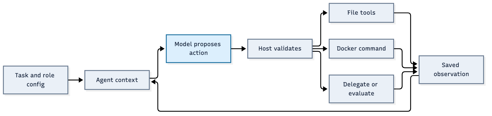

# ResearchSquad

A configurable research team that assigns specific jobs, implements experiments, measures frozen outputs and preserves evidence for the next decision. Every role uses the same `Agent` loop; JSON configuration selects its model, prompt and tools. The Python host controls execution, handoffs, workflow gates and protected evaluation.

Start with the **[operating and extension guide](docs/multi-agent-operating-guide.md)** or its **[PDF edition](output/pdf/researchsquad-operating-guide.pdf)**. It follows a run step by step and explains how to add agents, tools and evaluators.



## Run the current system

Requirements: Python 3.12, `uv`, a running Docker daemon, and an authenticated Codex CLI for live model calls. The included verification fixtures use scripted decisions and need no model calls.

```sh
uv sync --locked --group dev
docker pull python:3.12-slim@sha256:12316debbfb86890f6b2d825820612741ba527ad5a44e3902759141d572bfe8f

# A small task with a protected sorting evaluator.
uv run python -m goalagent.team \
  --task goals/team-sort.json --run-dir runs/my-team \
  --model gpt-6.1-sol --unlimited

# Music research with prepared notation/OCR tools and protected labels.
uv run python -m goalagent.music_team \
  --run-dir runs/my-music-team --model gpt-6.1-sol
```

Use a new run directory for each study. Music runs default to unlimited effort; the general CLI accepts `--unlimited` or a task with `"unlimited": true`. Usage is still recorded. Container resource limits, file/log bounds and protected completion checks remain active. Ctrl-C stops a foreground run and preserves its state.

The same command resumes a run only while its frozen task, prompts, tools, implementation and evaluator contract still match. Stopped and externally waiting runs need an explicit operator transition; see the guide. After a code change, use a fresh run. Existing evidence is never rewritten to make it resume.

## How work moves through the team

The coordinator gives a specialist a distinct objective, success criteria and explicit input files. The specialist chooses tool actions, writes and executes scripts in Docker, and returns a checkpoint or frozen submission. The coordinator can continue that assignment, commission a review, request protected evaluation, improve a measured candidate, or debug a failed one. Measurements and durable evidence records inform the next decision.

Eight default roles are configured in [agents/default](agents/default): coordinator, planner, researcher, experiment engineer, environment engineer, critic, experience and strategy. Roles are available for assignment; they are not all automatically called. Delegation currently runs sequentially, and agents exchange explicit handoffs rather than a shared conversation.

Agents can create specialists with a subset of an existing role's permissions and register tested Python scripts for later execution agents. They cannot register a replacement protected evaluator or grant themselves host shell access. An ordinary experiment script needs no tool registration.

## What belongs where

| Location | Purpose |
| --- | --- |
| `goalagent/` | Current team, shared agent loop, tools, handoffs, workflow and protected adapters |
| `agents/default/` | Editable role JSON and Markdown prompts, including the four pillars |
| `workflows/` | Workflow templates and gate definitions |
| `goals/` | Example tasks and the music evaluation/profile specification |
| `environments/` | Reviewed notation/OCR recipe, locked dependencies and readiness test |
| `research/data/`, `research/manifest.json` | Supplied music images and protected reference labels with original hashes |
| `research/baselines/first-benchmark/` | Preserved prediction inputs and historical metrics, with SHA-256 provenance |
| `scorebench/` | Standalone diagnostic benchmark and shared music metrics |
| `tests/` | Current runtime, scoring, checkpoint and isolation regressions |
| `runs/` | Local generated records, ignored by Git |

Run records include the charter, effective configurations, assignment inputs, model prompts, actions, full command logs, checkpoints, artifacts, measurements and decisions. Read the guide's inspection section to follow who tried what and why.

The music pilot supplies seven images and fourteen baseline/export artifacts. Labels stay with the evaluator. The delivered kern baseline has 101/130 melody errors and 38/38 chord errors, with three of seven files parseable. These are development diagnostics, not held-out accuracy. The conservative acceptance gate still requires all 32 excerpts, zero measured errors, successful transposition checks, audited chord timing and musician approval. A seven-sample pilot cannot complete that goal.

## Verify changes

```sh
uv run --no-sync pytest -q
GOALAGENT_DOCKER_TESTS=1 uv run --no-sync pytest -q \
  tests/test_sandbox.py tests/test_environments.py tests/test_budgets.py
uv run --no-sync python -m goalagent.environment_check --run-dir runs/check-environment
uv run --no-sync python -m goalagent.team_check --run-dir runs/check-team
uv run --no-sync python -m goalagent.checkpoint_check --run-dir runs/check-checkpoints
```

Use fresh directories for verification. These checks exercise actual Docker execution, image reuse, isolation, extension registration, inherited artifacts, checkpoint continuation, failed evaluation followed by improvement, and protected completion. Scripted fixtures verify the machinery; they do not establish autonomous research quality.

## Documentation and history

- [Operating and extension guide](docs/multi-agent-operating-guide.md): step-by-step control of agents, actions, tools and evaluators.
- [Configuration reference](docs/configurable-team.md): role definitions, capability grants and unlimited mode.
- [Checkpoint and workflow protocol](docs/checkpoints-and-workflows.md): durable handoffs, decisions, reviews and external events.
- [Environment operations](docs/environment-operations.md): setup ownership, immutable images and compact diagnostics.
- [PR feedback workflow](docs/pr-review-workflow.md): review implementation and research evidence together.
- [Cleanup and historical recovery](docs/repository-cleanup.md): removed entry points, retained inputs and archived records.

Older fixed-menu, coordinator/worker and blind-review runners have been retired from the active tree. Historical tracked runs and superseded reports remain in the `archive/pre-cleanup-20261030` tag and existing local files. The archive includes their original code and commands; do not run old state through the new runtime. Git history has not been rewritten.
