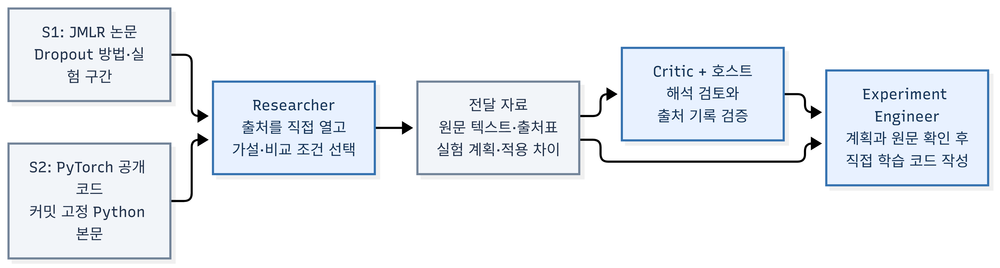

# 외부 자료를 읽고 설계한 Fashion-MNIST 연구: 실제 에이전트 업무 보고서

2026년 10월 31일 · ResearchSquad · 실행 `literature-live-01`

실제 모델 호출을 사용하는 역할들이 논문과 공개 코드를 열어 보고, 비교 실험을 설계하고, 학습 코드를 작성해 RTX 3080 Laptop GPU에서 두 번 학습했다. Dropout을 추가하면 정확도가 높아질 것이라는 가설은 이번 조건에서 지지되지 않았다. 기본 CNN의 검증 정확도는 **90.92%**, dropout 0.25를 넣은 CNN은 90.56%였다. 별도 추론 코드가 두 가중치를 재채점해 각각 같은 정확도를 확인했다. 사전 기준에 따라 기본 모델을 선택했다.

전체 workflow는 **COMPLETED**다. 출처 검토와 학습 후 세 역할 검토가 PASS였고, 호스트의 출처·모델 평가 gate도 통과했다. 이 수용은 출처에 연결된 제한 실험의 완료를 뜻한다. 정확도 개선·새 방법 발명·논문 재현의 성공을 뜻하지 않는다. 실행 도중 저장 오류를 해소하기 위한 중앙 담당자의 개입 1회가 있었다.

## 무엇을 누가 결정했는가

중앙 담당자가 특정 논문·저장소·dropout 확률이나 학습 코드를 답으로 제공하지 않았다. 중앙 담당자는 공개 자료를 읽는 도구를 연결하고, 데이터 분리·실행 한도·허용 모델 구조·필수 검토를 정했다. 사전 도구 점검에는 고정 URL을 사용했지만, 이 결과와 소스 파일은 실제 연구 역할의 입력에 넣지 않았다. 도구 점검을 에이전트의 검색 성과로 세지 않았다.

| 결정 | 결정 주체 | 실제 내용 |
| --- | --- | --- |
| 과제와 경계 | 중앙 담당자·호스트 정책 | Fashion-MNIST, 55,000/5,000 고정 분리, seed 1337, CUDA, 작업당 최대 5 epoch, 검토 후 최종 평가 |
| 실행 가능한 모델 범위 | 유지관리자 | 안전한 추론 레지스트리에 등록된 MLP/CNN·크기·dropout 범위. 임의의 새 추론 구조를 자동 승인하지 않음 |
| 자료·가설·실험 조건 | Researcher | Dropout 논문과 PyTorch 예제, CNN 채널 32/64·은닉층 128, dropout 0 대 0.25, Adam 0.001, batch 128, 정확히 5 epoch |
| 모델 선택·중단 규칙 | Researcher | 마지막 epoch 검증 정확도에서 B가 A보다 높을 때만 B 선택. 동률은 A. 정상 실험 2개 후 종료 |
| 구현과 실행 순서 | Experiment Engineer | 원본 학습 루프 작성, A 완료·지표 확인 후 B 시작, 유한 값·내보내기 검사, 선택과 산출물 제출 |
| 문서·해석의 수용 여부 | 별도 문맥의 역할 검토자 | 출처 해석, 코드·작업·지표의 연결, 보고서 이해 가능성을 각각 검토 |
| 단계 진행과 수치 검증 | Coordinator·호스트 | 필수 검토와 출처 검증을 충족해야 진행. 최종 추론에는 에이전트 Python을 가져다 실행하지 않음 |

CNN과 MLP를 모두 학습해 비교한 것은 아니다. 이번에는 에이전트가 선택한 CNN 안에서 dropout이라는 한 요인을 비교했다. B의 조건은 학습 전에 정했다. A의 결과를 읽고 정상 실행임을 확인한 후 예정한 B를 실행했으며, 정확도에 맞춰 새로운 확률을 계속 탐색하지 않았다.

## 외부 자료를 실제로 어떻게 찾고 읽었는가

Researcher는 먼저 허용 모델 정의를 읽고, dropout을 분리해 실험할 수 있다는 이유로 이 방법을 후보로 골랐다. 즉, 낯선 논문을 광범위하게 발굴한 연구라기보다 익숙한 방법 후보를 외부 원문으로 확인한 제한된 연구다. 검색 과정을 성공한 것처럼 뭉뚱그리지 않으면 다음과 같다.

| 실제 행동 | 응답과 후속 판단 |
| --- | --- |
| Crossref에 Dropout 원 논문의 제목·저자를 질의 | 관련 논문은 반환했지만 원 논문을 식별하지 못함. 해당 결과를 원 논문 발견으로 쓰지 않음 |
| DuckDuckGo에 원 논문을 구체적으로 질의 | 봇 차단 페이지. usable source로 인정하지 않고 다른 제공자로 전환 |
| GitHub에서 dropout/Srivastava 저장소 검색 | 제3자 저장소 후보 하나를 찾았으나 Python 본문 확인이 없어 채택 구현으로 쓰지 않음 |
| JMLR 공식 논문 소개 페이지 직접 열기 | 논문 제목·저자·PDF 링크를 확인하고 그 PDF를 열었음. 원 논문 주소를 찾은 경로는 검색 결과가 아니라 공식 소개 페이지 확인 |
| GitHub에서 pytorch examples 검색 | 공식 예제 저장소를 식별하고 GitHub API로 커밋을 확정한 뒤, 그 커밋의 `mnist/main.py`를 읽음 |

외부 검색 행동은 4회, 직접 페이지·파일 요청은 4회였다. 검색 응답이 있었다는 사실과 관련 자료를 찾았다는 사실은 다르다. 검색은 포괄적이지 않았으며, 더 나은 방법이 없다는 결론을 내릴 근거가 없다.

S1은 Srivastava 등의 [Dropout: A Simple Way to Prevent Neural Networks from Overfitting](https://jmlr.org/papers/volume15/srivastava14a/srivastava14a.pdf)이다. 논문에서 훈련 중 활성값을 무작위로 제거하는 방법과 그 동기를 확인했다. 이로부터 **같은 CNN에서 hidden dropout만 바꿔 정확도 개선 가설을 시험한다**는 계획을 세웠다. 논문의 결과를 Fashion-MNIST에서 이미 입증된 결과로 취급하지 않았다.

S2는 [PyTorch 공식 MNIST 예제의 고정 커밋 Python 코드](https://raw.githubusercontent.com/pytorch/examples/acc295dc7b90714f1bf47f06004fc19a7fe235c4/mnist/main.py)이다. 모델과 train/test 함수를 직접 열어 훈련·평가 모드 전환을 확인했다. 이로부터 자체 학습 코드의 `model.train()`, `model.eval()`, 추론 시 gradient 비활성화에 연결했다. 외부 파일을 실행하거나 그 파일의 test 다운로드 경로를 복사하지 않았다.

### 추출한 분량과 모델에 실제 들어간 분량

PDF의 30쪽은 제한 컨테이너에서 텍스트로 추출됐다. 30쪽 전부를 모델이 읽었다는 뜻은 아니다. 인용한 두 본문 읽기 결과와 그 다음 모델 프롬프트를 직접 대조했다.

| 자료·읽기 위치 | 도구가 반환한 문자 수 | 바로 다음 모델 입력에서 확인한 본문 문자 수 |
| --- | ---: | ---: |
| S1 텍스트 byte offset 14,000, 최대 8,000 bytes 요청 | 7,914 | 3,487 |
| S1 텍스트 byte offset 21,000, 최대 8,000 bytes 요청 | 7,936 | 3,506 |
| S2 Python 본문 처음부터 | 5,392 | 5,392 |

긴 도구 결과를 최근 문맥에 넣을 때 직렬화한 4,000자 미리보기로 줄이는 기존 정책 때문에 차이가 생겼다. 두 논문 구간에서 약 7천 자가 실제로 전달됐고, 공개 코드 본문은 전부 전달됐다는 범위로 말할 수 있다. 본문 전체 이해나 논문의 모든 실험 조건 파악을 증명하는 수치는 아니다. 논문 전체·부록을 읽었다고 주장하지 않았다. 원본과 읽기 결과는 변경할 수 없는 산출물로 보존하고, 제출된 텍스트와 원본이 일치하는지도 호스트가 확인했다.

## 역할 사이에 무엇을 전달했는가

Researcher가 넘긴 것은 링크 목록만이 아니었다. `sources.json`에는 S1/S2의 제목·URL·다운로드 기록·읽기 기록·확인한 구간·발견한 내용·채택할 판단·적용 한계를 넣었다. `literature.md`에는 자료의 주장과 이 과제에서 검증할 가설을 구분했다. `plan.md`에는 두 조건, 데이터 분리, optimizer, seed, 마지막 epoch 선택 규칙, 중단 조건을 적었다. 인용한 원문 텍스트도 같이 보존했다.

출처 Critic은 이 묶음의 논문 구간과 Python 본문을 별도 문맥에서 열어 해석과 계획을 점검했다. 그 후 호스트가 다운로드·읽기·발견 기록의 소유자와 원본 텍스트를 대조했다. 두 절차가 통과한 뒤 Experiment Engineer가 같은 자료와 계획을 받아 구현했다. 이때 Critic의 문서 검토와 호스트의 기계적인 출처 검증은 서로 다른 책임이었다.

학습 뒤에는 코드, 두 작업의 실제 metrics/log, 선택 모델 참조, 실험 기록, 출처 영향 표, 자체 완결적인 영문 보고서를 넘겼다. Researcher와 Critic은 원자료·코드까지 확인하는 별도 검토를 받았다. Report Reader는 Engineering의 보고서만 받았으며, 원시 실행이나 사실을 독립 재현한 역할로 세지 않았다. 이 한글 종합 보고서는 중앙 담당자가 원본 기록과 추가 검증 결과를 종합한 문서다.

## 자료가 코드와 실험의 어디에 영향을 주었는가

| 자료 | 기록된 판단 | 실제 코드·작업과의 연결 | 관측 결과·제한 |
| --- | --- | --- | --- |
| S1 Dropout 방법 논문 | 동일 CNN에서 hidden dropout 효과를 시험 | `train.py`의 dropout 인자, model spec 생성, 검토된 builder 호출. 같은 코드로 A=0, B=0.25 실행 | B 정확도가 0.36%p 낮아 A 선택. 논문을 읽었다고 B를 자동 채택하지 않음 |
| S2 PyTorch 예제 본문 | 훈련의 확률적 동작과 평가의 결정적 동작을 분리 | epoch 루프의 `model.train()`, `validate()`의 `model.eval()`·`torch.inference_mode()`, 재로딩 모델 검증 | 두 실험에 공통 적용. 모드 전환 자체의 정확도 기여량을 분리해 측정한 것은 아님 |
| 자료와 구분되는 자체 설계 판단 | 짧은 과제 안에서 통제 가능한 실험 선택 | CNN 크기, Adam, 학습률, batch, 5 epoch, hidden 위치의 확률 0.25 | 이 값들이 논문이나 공개 코드에서 최적이라고 증명됐다는 주장은 하지 않음 |

원 논문과 공개 예제는 주로 다른 데이터·구조·훈련 조건을 사용한다. 공개 예제는 digit MNIST, 정규화한 입력, 두 dropout 위치, 14 epoch, Adadelta와 StepLR 등을 사용한다. 이번에는 Fashion-MNIST의 raw [0,1] 입력, padding한 두 convolution과 두 pooling, 은닉층 128과 dropout 한 위치, Adam과 5 epoch를 사용했다. 따라서 **원리를 가져온 실험**이며 정확한 논문·구현 재현이 아니다.

`source-influence.json`은 S1/S2 각각을 판단, 실제 코드 위치, 두 작업 ID, 관측 결과, 한계에 연결했다. 이 연결은 역할이 명시한 근거와 코드·작업 기록의 일치성을 보여준다. 비공개 사고나 자료가 없었을 때의 반사실적인 판단까지 관찰했다는 뜻은 아니다.

## GPU 학습과 선택이 실제로 진행된 순서

Experiment Engineer가 직접 작성한 학습 루프는 검토된 로더와 모델 builder만 import했다. CUDA가 없으면 실패하도록 하고 seed와 네 개 CPU thread를 고정했다. 첫 55,000개만 optimizer에 넣고 마지막 5,000개는 평가에만 사용했다. 두 모델의 초기 가중치와 epoch별 입력 순서가 같도록 dropout 난수와 별개인 sampler를 사용했다.

A를 시작하고 완료를 기다린 뒤 실제 `metrics.json`을 읽었다. 2,150 optimizer step과 정상 손실·gradient·가중치 재로딩 결과, 90.92% 정확도를 확인한 다음 공개 결정 기록을 남기고 B를 시작했다. B의 완료 결과를 읽은 후 사전 기준대로 A를 고정했다. 모델 선택 뒤에는 B의 손실이 더 낮다는 이유로 선택 기준을 교체하지 않았고 추가 확률 탐색도 하지 않았다.

Engineering의 행동 번호로 보면 **18: A 지표 첫 읽기 → 19: B 진행 결정 → 20: B 시작 → 23: B 지표 첫 읽기 → 24: A 선택** 순서다. 32/33번 지표 읽기는 이후 보고서 작성용 재확인이었다. Report Reader는 원래 영문 보고서가 뒤의 번호를 근거로 적어 선택 전후 순서를 모호하게 만들었다는 MINOR 지적을 남겼다. 실행 유효성을 부정하거나 재학습을 요구한 지적은 아니었다. 이 보고서에서는 두 종류의 읽기를 구분했다.

| 항목 | A: dropout 0 | B: dropout 0.25 |
| --- | ---: | ---: |
| 마지막 epoch 검증 정확도 | 90.92% (4,546/5,000) | 90.56% (4,528/5,000) |
| 별도 코드로 가중치 재채점 | 90.92% | 90.56% |
| 마지막 학습 손실 | 0.230177 | 0.254702 |
| 검증 cross-entropy | 0.253086 | 0.251311 |
| 총 optimizer step 수 | 2,150 | 2,150 |
| 총 epoch 수 | 5 | 5 |
| 작업 내부 기록의 실행 시간 | 15.810초 | 19.017초 |
| 선택 여부 | 선택 | 선택하지 않음 |

두 코드 사본과 공통 helper가 같은지, hyperparameter·분리·초기화·epoch별 입력 순서가 같은지도 추가 대조했다. 해당 비교는 고정된 코드와 작업의 기록을 확인한 것이며 최적화 과정을 별도로 처음부터 재학습한 실험은 아니다.

실제 장치는 RTX 3080 Laptop GPU, PyTorch 2.9.1+cu128, CUDA 12.8이었다. 두 작업 내부 시간 합계는 약 34.827초다. 전체 팀의 35.06분과는 측정 범위가 다르다. 전체 시간에는 모델 응답, 자료 확보, 역할 검토, 저장 오류와 재개가 포함된다. GPU 사용률 100%나 장시간 훈련의 효율은 측정하지 않았다. 이번 작은 실험의 병목은 학습 연산보다 준비와 검토였다.

## 무엇을 독립 검증했고, 무엇은 검토에 그쳤는가

학습 코드의 유한 값 검사·strict reload·동일 tensor 확인은 작업 내부 검사다. 역할 검토는 별도 문맥에서 자료·코드·로그를 읽는 검사다. 두 가중치를 별도 CPU 컨테이너에서 유지관리자 소유의 추론 코드로 채점한 것은 수치 검증이다. 에이전트의 `train.py`를 평가 호스트로 import해 실행하지 않았다. 세 층위를 같은 의미의 독립 재현으로 부르지 않는다.

선택이 고정되고 필수 검토가 끝난 뒤 호스트가 기본 모델 A를 평가했다. 검증 5,000개에서 **90.92%**, 공식 test 10,000개에서 **90.23% (9,023/10,000)**, test cross-entropy **0.272166**였다. 이번 실행에서 공식 test는 이 선택 모델에 한 번만 사용했다. B의 test 점수는 측정하지 않았으며 test 결과를 보고 조건을 바꾸지 않았다. 모델 평가의 수용 기준은 연구 산출물의 유효한 완료이지 특정 정확도 초과가 아니었다.

프로젝트의 이전 실험들도 공개 Fashion-MNIST test를 사용했다. 이번 실행에서 선택 후 한 번 평가했다는 의미이며, 전체 프로젝트에서 처음 보는 비공개 holdout이라는 뜻은 아니다. 역할 검토자들은 같은 모델 계열의 서로 다른 문맥이므로 오류와 편향이 통계적으로 독립이라고 주장할 수 없다.

## 각 역할이 남긴 결과와 비용

| 역할·시도 | 실제 모델 응답 | 받은 자료와 수행 업무 | 결과 |
| --- | ---: | --- | --- |
| 논문·구현 담당 Researcher | 27 | 허용 구조 확인 → 검색·원문 읽기 → 가설과 통제 조건 | 출처·문헌 요약·사전 계획 제출 |
| 첫 출처 Critic | 19 | 원문과 영수증 대조 중 저장 오류 | 19개 완료 행동 뒤 중단; 모델 호출 전 예약 1건 추가 |
| 재배정 출처 Critic | 31 | 같은 고정 자료를 새 문맥에서 검토 | 출처 해석·적용 차이 검토 PASS |
| Experiment Engineer | 45 | 계획과 원문 확인 → 자체 코드 → GPU 2회 → 선택 | 부정적 B 결과 보존, A만 등록, 제출 목록 자체 수정 |
| 학습 후 Researcher | 31 | 코드·실행 순서·출처 영향·지표·모델 참조 대조 | 연구 검토 PASS; 문서 근거 제출 오류 자체 수정 |
| 학습 후 Critic | 24 | 데이터 분리·실행 영수증·출력 전달·등록 확인 | 독립 artifact/실행 검토 PASS; 수치 독립 재현은 아님 |
| Report Reader | 3 | Engineering 보고서만 읽기 | PASS + 선택 전후 지표 읽기 번호의 모호함 MINOR 지적 |
| Coordinator | 9 | 상태 재확인 → 출처 평가·진행 → 모델 평가·완료 | 필수 검토 후 두 단계 완료 요청; 호스트 gate 적용 |

실제 provider는 모든 역할에서 gpt-6-astra였다. 역할의 설정된 effort를 유지했다. 모델 호출 예약은 **190회**, 실제 응답은 **189회**였다. 1건은 상태 저장 실패로 모델 실행 전에 끝난 예약이다. 같은 모델 계열의 별도 문맥을 이용했으며 사람 전문가 여러 명이 검토한 결과로 표현하지 않는다. 위 수치는 본 연구 실행만의 집계이고 중앙 담당자의 개발·도구 점검·추가 보고서 검토는 포함하지 않는다.

역할 배정은 모델이 매번 직원을 자유롭게 고르는 방식이 아니었다. workflow의 SOURCES 소유자는 Researcher, STUDY 소유자는 Experiment Engineer로 고정했다. 웹 접근은 전자에게, GPU 작업 시작 권한은 후자에게 부여했기 때문이다. 필수 검토 역할도 workflow에 선언했다. Coordinator는 그 경계 안에서 평가와 단계 진행을 요청했고, 호스트가 권한과 gate를 검사했다.

## 실제로 막혔거나 불필요하게 반복한 업무

**공개 검색이 막힌 경우:** 원 논문을 찾으려던 DuckDuckGo 요청이 봇 차단으로 실패했다. Researcher가 제공자를 바꾸고 JMLR 공식 소개 페이지와 GitHub 검색·API를 사용했다. Crossref에서 원 논문을 못 찾았다는 제한도 유지했다. 검색 실패를 성공으로 기록하지 않았다.

**상태 저장이 막힌 경우:** 첫 출처 Critic의 20번째 모델 호출을 예약하는 시점에 `team-state.json.tmp`를 `team-state.json`으로 교체하지 못하는 Permission denied가 발생했다. 모델 실행 전의 오류였고, 앞선 완료 행동은 19개였다. Windows의 `Get-Content`로 실시간 파일을 읽던 중앙 모니터링과 WSL 교체 쓰기의 파일 공유 충돌이 의심되지만, 원인을 단정할 별도 재현 실험은 하지 않았다. 모니터링을 Linux 쪽으로 바꾸고 같은 폴더에서 교체 쓰기 10회를 확인했다.

이후 중앙 담당자가 공식 외부 이벤트 API에 저장 점검 결과를 넣어 재개했다. 논문·계획·평가 기준이나 과학적 gate를 바꾸지 않았다. 그러나 현재 대기 복구 경로는 같은 Critic의 진행 상황을 이어 쓰지 않고 새 검토 시도를 만들었다. 두 번째 Critic은 31개 행동 뒤 출처 검토를 마쳤다. 첫 19개 완료 행동의 비용이 중복됐다는 뜻이다. 이 복구는 에이전트가 저장 시스템을 스스로 고쳤다는 증거가 아니라 **운영자 개입 1회가 필요한 실행**이었다.

**보고서 제출 목록 오류:** Engineering이 읽기 전용 `inputs/protocol.txt`까지 제출 파일로 지정해 거부됐다. 입력은 이미 호스트가 보존하므로 작업자가 작성한 산출물만 제출해야 한다. Engineering이 오류와 복구 항목을 checkpoint에 기록하고 목록을 고친 뒤 같은 모델·같은 실험 결과를 제출했다. 잘못된 수치를 고치거나 재학습한 사례는 아니다.

**검토 결과의 근거 종류 오류:** 연구 검토자는 실제 PASS를 기록한 뒤 그 review 결과 ID를 observed 문서 주장의 근거로 넣었다. 현재 검증기는 이를 전달 문서의 근거로 인정하지 않아 제출을 거부했다. 검토자가 `research-review.md`를 직접 작성하고 그 작성 행동의 영수증을 근거로 삼아 다시 제출했다. 검토 verdict와 모델을 바꾼 것은 아니다. 필수 필드 형식과는 별개로 사건 기록·문서 근거의 구분이 도구 사용 비용을 만든 사례다.

**완료한 내용을 다시 읽는 비용:** Researcher는 같은 모델 builder 구간을 세 번 읽었다. 두 번째 출처 Critic도 이미 확인한 출처 영수증을 다시 열었다. Engineering은 보고서 작성 단계에서 계획·소스 목록·자신의 코드·게시한 지표를 다시 읽었다. 현재 모델 입력에는 최근 결과 여섯 개와 자유 형식 progress 요약이 들어간다. 이 구조가 오래된 확인 상태를 유지하기 어렵게 한다는 것은 코드와 행동 기록을 바탕으로 한 중앙 담당자의 해석이며, 모든 재확인이 불필요했다고 단정할 수는 없다. 동일 assignment 안에서 같은 파일·offset·limit 또는 같은 영수증·offset을 다시 읽은 추가 행동은 **21회**였다. 서로 다른 역할이 독립적으로 같은 자료를 읽은 횟수는 이 집계에 넣지 않았다. 이 숫자는 반복 읽기의 관측값이며 모두 제거할 수 있는 낭비라는 뜻은 아니다.

도구 준비 점검에서는 상대 실행 경로를 쓴 managed fixture가 재열기 시 작업 디렉터리를 해석하다 FileNotFoundError를 냈다. 새 절대 경로 실행은 통과했다. 근본 원인은 이번 과제에서 확정하지 못했다. 실제 연구 실행에는 처음부터 절대 경로를 사용했다.

## 유지할 부분과 다음에 고칠 부분

유지할 부분은 하나의 재사용 Agent, 역할별 prompt·도구 권한, Team의 단일 상태 기록, 원문과 읽기 기록의 보존, 결과를 본 뒤 남기는 공개 선택 기록, 작업 출력의 직접 전달, 부정적 결과의 보존, 보고서만 받는 별도 검토 문맥이다. 이번에는 자료를 열지 않았는데 읽었다고 간주하거나, 논문 기법을 넣었으니 개선됐다고 승인하지 않았다.

우선 고칠 것은 다음과 같이 구체적이다.

1. **상태 교체 쓰기와 검토 재개:** 일시적인 파일 공유 오류의 제한 재시도와, 부작용이 없던 모델 호출 전 오류에서 동일 검토를 이어가는 경로가 필요하다. 지금은 정상 연구 검토가 저장 오류 하나로 중복됐다.
2. **기계적인 출처 대조를 먼저 제공:** 호스트가 확인할 수 있는 원본·영수증·읽기 구간 체크 결과를 의미 검토 전에 제공하면 Critic이 같은 ID를 여러 번 대조하는 비용을 줄일 수 있다. 이것이 논문 해석을 자동 승인해서는 안 된다.
3. **읽기 결과와 모델 문맥 한도를 일치:** 8,000 bytes를 요청해도 모델에는 직렬화한 4,000자 미리보기만 들어갈 수 있다. 전달된 본문·다음 offset을 명시하는 방식으로 바꾸고 읽기 분량 gate도 실제 전달 범위와 맞춰야 한다.
4. **검토 완료 항목의 구조화:** 논문 해석·구현 확인·표본 분리·지표 대조 각각의 상태와 근거를 지속적인 checklist로 남겨야 한다. 자유 형식 checkpoint만으로는 완료한 검증이 반복됐다.
5. **더 넓은 과학적 검증:** 이번 한 seed·한 split·두 조건·5 epoch로 dropout의 일반 효과나 새로운 방법 발명을 주장할 수 없다. 여러 seed, 더 긴 예산, 대체 방법·논문을 비교하는 다음 연구가 필요하다. 허용 구조도 현재의 안전한 레지스트리 안으로 제한됐다.

자료 검색·읽기·선택·학습·역할 검토는 실제 모델 호출이었다. 공개 자료 도구의 준비 확인과 managed fixture의 결정은 고정 시나리오였으며 별도로 기록했다. 전체 회귀 테스트는 **141 passed, 3 skipped**였고, 실제 Docker managed fixture는 실패 측정→수정→별도 검토→완료와 재시작 추가 호출 0을 확인했다. skipped 세 항목을 실행한 것으로 세지 않았으며 GPU 학습과 별도 추론은 이번 실제 실행에서 따로 확인했다.

## 기록과 재실행

원본 실행은 `projects/researchsquad/tmp/literature-live-01/`에 있다. 공유용 요약과 trace는 `sessions/01a183b6-agent-system/reports/literature-study-20261031/`에 보존했다. `live-agent-trace.html`은 prompt, 도구 권한, 공개 why·후보, 실제 도구 결과·오류, 검토와 호스트 개입을 보여준다. 비공개 사고나 모델의 모든 내부 후보를 보여주는 기능은 아니다.

`verification.json`에는 역할·검색·공개 결정·작업·검증·반복 읽기 집계를 넣었다. 작업별 자체 학습 코드·지표·로그도 보존했다. 원문 PDF·공개 소스 본문·데이터셋·가중치·원시 trace는 Git에 넣지 않고 로컬 기록으로 남겼다. 공개 보고서에는 실험을 이해하는 데 필요한 결과와 한계를 넣고 내부 무결성 값은 나열하지 않았다.

새 실행은 WSL의 잠긴 Python 3.12 환경에서 `python -m goalagent.literature_live --run-dir <새 절대 경로>`로 시작한다. GPU 학습 이미지와 pypdf 6.21.4 소스 리더 이미지를 먼저 준비해야 하며 실제 provider 로그인이 필요하다. 소스 리더의 실제 네트워크 점검은 `python -m scripts.source_readiness --run-dir <새 절대 경로>`다. 고정 점검 URL과 실제 역할의 자료 선택을 혼동하지 않아야 한다.

완료된 같은 contract를 재열어 모델 호출 예약 **190→190**, 학습 작업 **2→2**가 유지됨을 확인했다. 최종 test 결과 파일의 내용과 수정 시각도 그대로였다. 재시작 때문에 학습이나 최종 test를 다시 실행하지 않았다.

## 종합 보고서의 추가 검토 기록

이 절은 위 본문과 도식에 대한 검토가 끝난 뒤 중앙 담당자가 붙인 운영 기록이다. 최종 독립 검토 대상은 그 전의 본문 25,245 bytes와 포함 도식이며, 아래 사후 기록까지 검토자가 읽었다고 주장하지 않는다.

추가 Report Reader에는 실험 대화·코드·원시 로그·다른 검토자의 문맥을 주지 않고 보고서와 도식만 전달했다. 세 시도의 모델 응답은 각각 **24회·6회·7회**, 합계 **37회**다. 본 연구의 190회 예약/189회 응답과 별도이며, 두 범위를 합하면 227회 예약/226회 응답이다. 이 추가 검토 시간은 앞서 적은 본 연구 35.06분에 포함되지 않는다.

첫 시도는 표의 ‘optimizer step / epoch’가 epoch당 값처럼 읽힐 수 있다고 지적했다. 이를 ‘총 optimizer step 수’와 ‘총 epoch 수’로 나누어 고쳤다. 그러나 검토자가 objection의 대상에 등록된 artifact ID 대신 문서 경로와 구절 이름을 넣어 세 번 거부됐다. 이미 읽은 본문을 다시 읽다가 24회 후 checkpointed 상태로 끝났으며 정식 제출은 수용되지 않았다. PNG를 read_file로 읽은 결과도 시각적 검토로 인정하지 않았다.

두 번째 시도에서는 대상 ID 사용법을 명시했다. 본문을 다 읽은 뒤 도식을 보려다 중앙 담당자가 해당 설정에 view_image 권한을 넣지 않았음을 확인했고, 6회 후 그 조건을 구체적으로 요청하며 멈췄다. 이 경우는 도구가 있는데 사용하지 않은 문제로 돌릴 수 없다. 본문만 읽는 기본 역할에 그림까지 전달한 배정 설정이 불완전했다.

세 번째 시도는 같은 읽기 전용 범위에서 view_image 권한을 명시한 새 문맥으로 실행했다. 본문을 비중복 다섯 구간으로 읽고 도식을 실제 이미지로 확인한 뒤 7회째 DONE을 제출했다. 행위자·전달 자료·실험 조건·선택 기준·결과·한계를 이해하는 데 중대한 모호함이 없다는 결론이었다. 과학적 사실 검증이나 프로젝트 gate 승인을 한 것은 아니다.

이 과정은 보고서 오류를 잡는 독립 검토의 효용과 함께, ‘허용되는 objection 대상 ID’를 더 명확히 제공하고 입력 형식에 필요한 도구를 배정 전에 확인해야 한다는 추가 개선 과제를 보여준다. 이번에는 기본 런타임의 target ID 규칙을 바꾸지 않고 독립 검토 설정·지시문을 바로잡았다. 첫 두 시도의 비용과 중단도 trace에 보존했다.
