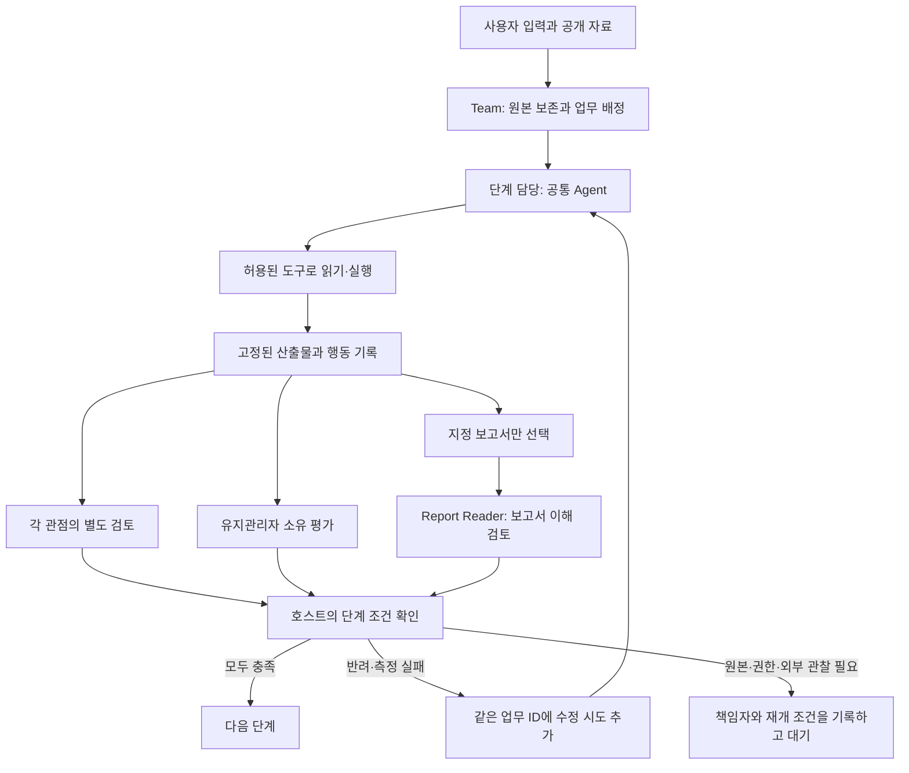

# ResearchSquad에 적용한 팀 운영 구조

이 저장소를 앞으로의 작업 기반으로 사용한다. 기존 팀의 원리를 별도 런타임으로
복사하지 않고, ResearchSquad의 공통 `Agent`, 역할 설정, 도구 등록, Docker 실행,
체크포인트, 보호된 평가 위에 적용했다. 이 문서는 구현 설명이다. 악보 인식 성능이
개선되었다는 실험 보고서는 아니다.

## 어디를 고치면 되는가

| 바꾸려는 내용 | 수정할 파일 |
| --- | --- |
| Research가 어떤 근거를 찾고 어떻게 판단할지 | `agents/default/researcher.md` |
| Engineering에 어떤 도구와 모델을 줄지 | `agents/default/experiment_engineer.json` |
| 제품·연구의 단계별 담당자, 필수 검토자, 산출물 | `workflows/product.json`, `workflows/research.json` |
| 업무 ID, 의존 관계, 준비된 업무 선택 | `goalagent/workboard.py` |
| 자동 배정, 반려, 재시도, 환경 복구 | `goalagent/stage_runtime.py` |
| 제출 보고서 형식과 실행 근거 검사 | `goalagent/reports.py`, `goalagent/claim_checks.py` |
| 악보 입력과 보호된 채점의 연결 | `goalagent/music_team.py` |

역할마다 새로운 Agent 클래스를 만들지 않는다. 같은 `Agent`에 Markdown 판단 지침과
JSON 도구 권한을 넣는다. 단계상 반드시 해야 하는 업무는 모델의 자발적인 기억에
맡기지 않고 워크플로 설정과 호스트가 배정한다.

## 연구 업무가 진행되는 순서

| 단계 | 주 담당 | 별도로 배정되는 검토 관점 | 필수 산출물·행동 |
| --- | --- | --- | --- |
| R0 질문·범위 정의 | Research | Strategy, Engineering, Experience | `charter.md` |
| R1 기존 지식 확인 | Research | Engineering, Auditor, Experience | `literature.md`, 실제 검색과 페이지 읽기 |
| R2 가설·검증 계획 | Research | Engineering, Strategy, Auditor | `experiment-plan.md` |
| R3 환경·파일럿 실행 | Engineering | Research, Auditor | `pilot-report.md`, `trace.json`, 실제 실행과 보호된 측정 |
| R4 검증 결과 분석 | Research | Engineering, Auditor | `validation-report.md`, 측정, 운영자가 전달한 원본 관찰 |
| R5 독립 확인 | Research | Engineering, Auditor | `confirmation-report.md`, 신뢰된 외부 확인 |
| R6 결과 패키징 | Research | Engineering, Experience, Strategy, Auditor, Report Reader | `report.md`, 보호된 최종 성공 판정 |

제품 모드는 목적 정의 → 문제·대안 확인 → 후보·검증 계획 선택 → 실제 가치 관찰 →
구현 → 제한된 운영 → 확장 확인 순서다. 해당 단계의 책임은 각각 Strategy,
Experience, Strategy, Experience, Engineering, Experience, Strategy가 맡는다.
각 단계의 정확한 검토자와 조건은 `workflows/product.json`에 선언되어 있다.
실제 사용자 관찰이 필요한 조건은 모델이 작성한 가상 인터뷰로 통과할 수 없다.

## 자료는 누구에게 어떻게 전달되는가

검토자는 담당자의 고정된 제출물과 그 행동 기록을 받는다. 다른 검토자의 결론은
자동 문맥에 들어가지 않으며, 동료 검토 기록을 조회하는 도구도 차단한다.
Report Reader에게는 설정된 보고서 파일만 전달한다. 원래 대화, 코드, 전체 업무판,
다른 검토자의 의견을 보고 판단하는 역할이 아니다. 보고서가 이해되는지 확인하는
역할이며, 실험을 독립 재현했다고 간주하지 않는다.

## 충돌과 실패를 실제 업무로 바꾸는 규칙

업무 `W-0001`에는 목적, 책임자, 입력, 필수 행동·산출물, 수용 조건이 기록된다.
코드 저장과 실행은 이 업무의 연속된 행동이다. 체크포인트는 같은 시도를 이어가고,
수정이 필요하면 새 Assignment를 같은 업무에 연결한다. 이전 제출물과 측정은 남긴다.

* **실행 없이 코드만 제출:** `run` 필수 조건이 충족되지 않아 호스트가 반려한다.
* **정상 실행했으나 점수 미달:** 측정된 부모 제출물에 `improve` 시도를 연결한다.
* **문서·구현 검토에서 반려:** 실패한 검토와 수정 조건을 근거로 `revise`한다.
* **실행 환경 부족:** Environment Engineer에게 준비 업무를 배정하고, 준비 결과가
  확인되면 원래 업무를 새 환경의 `debug` 시도로 이어간다.
* **MAJOR/BLOCKER 이견:** 문제 문장, 자료, 해결 여부를 확인할 시험을 별도 업무로
  만들고, 원래 제출물도 수정 대상으로 돌린다. 강한 어조만으로 의견이 채택되지는 않는다.
* **도구·원본 자료 부족:** 가능한 역할에 넘기거나 `operator` 책임의 업무와 재개
  조건을 남긴다. 수행 가능한 일이 소진되면 대기한다.

필수 검토자 모두가 각각 통과해야 한다. 새 제출물에는 검토를 다시 배정한다.
`next_actions`는 제안이며 자동 배정이 아니다. 실제 추가 배정을 요청하려면 구조화된
`work_items`를 제출해야 한다. 기존 업무를 언급할 때는 해당 W-ID를 사용하여 중복을
줄이고, 원래의 수용 조건을 임의로 낮추지 않는다.

## 이전에 지적된 누락을 어떻게 다루는가

R1 담당에게 인터넷 검색·페이지 읽기 도구를 연결하고 실제 성공 기록을 요구한다.
악보 작업의 R1에는 HOMR와 Audiveris의 처리 상태와 선택·제외·보류·미실행 이유를
각각 기록하도록 요구한다. 보류·미실행에는 후속 행동이 필요하다. 이 조건은 두
프로그램의 설치와 비교가 이미 완료되었다는 뜻이 아니다.

기본 검색은 공개 DuckDuckGo HTML을 사용한다. 실제 연결 검사에서 봇 확인 화면이
응답 코드 200으로 돌아온 경우를 발견했다. 이 화면은 `access_blocked`로 기록하고
검색 성공으로 인정하지 않는다. 공식 주소를 알고 있으면 직접 읽거나, 다른 허가된
검색 수단·운영자가 제공할 검색 자료를 구체적인 업무로 요청한다. 공급자가 막힌
상태를 전체 공개 프로그램을 검색한 결과라고 쓰지 않는다.

보고서의 `execution_records`는 해당 담당자가 수행한 도구, 대상, 성공 기록과
맞아야 한다. 다른 사람이 읽은 페이지나 실행한 명령을 자신의 실행으로 적으면
거부한다. 일반 문장의 모든 의미까지 자동 판정하는 기능은 없으므로 검토와 보호된
평가가 계속 필요하다.

최종 악보 승인은 같은 제출물의 수치 조건과 코드 시점·음악가 검토를 함께 확인한다.
사람의 통과 판정으로 나쁜 점수나 누락 샘플을 덮을 수 없다. 승인 철회 시에는 현재
유효한 승인 결과를 다시 계산하며, 기존 측정과 승인 이력은 별도로 보존한다.

## 실행과 검증의 범위

Linux 또는 WSL, Python 3.12, Docker에서 실행한다. 준비와 명령의 상세 내용은
[영문 운영 가이드](managed-workflow.md)에 있다. `goalagent.managed_check`는 정해진
모델 응답과 실제 Docker를 사용해 실패 → 개선 → 검토 → 통과를 확인하는 검사다.
`goals/managed-sort.json`은 실제 모델이 같은 인터페이스로 작업하는 작은 예제다.

악보 실행은 기본적으로 32개 전체 샘플과 유한한 예산을 사용한다. 기존 `.krn`
산출물·보호된 정답·채점식은 유지한다. 인식 알고리즘, MusicXML 변환, 전조 악보의
실사용 완성도와 100% 정확도를 이번 변경으로 달성했다고 주장하지 않는다.

최종 시험 결과와 실패·수정 내역은
[`verification/managed-workflow-20261030.json`](verification/managed-workflow-20261030.json)에
남긴다. 변경된 코드·프롬프트·권한·목표로 실행할 때는 새 실행 폴더가 필요하다.
기존 실행 기록을 새 구현의 성공 근거로 덮어쓰지 않는다.
