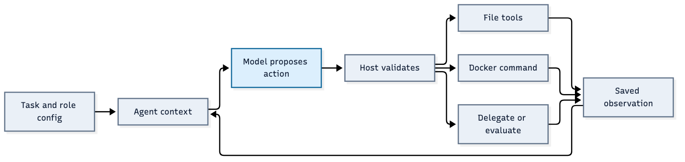

# Operating and extending ResearchSquad

A practical guide to the configurable multi-agent system

**Implementation covered:** the configurable team after the 30 October 2026 repository cleanup (based on `caad09f`). The examples describe the implementation shipped with this guide. They do not assume that every part of the four-pillar proposal is enforced.

ResearchSquad gives a research lead a goal, lets the lead commission specific assignments, and records the resulting work and measurements. Every person on this team is an instance of the same `Agent` class. A configuration supplies that person's instructions, model choice and permitted tools. Python code owns execution, files, budgets and acceptance checks.

Read sections 1-6 to understand a run. Use sections 7-12 to change it. Sections 13-15 explain how to operate, inspect and troubleshoot it. All terminal commands assume the repository root as the working directory. Commands with a live model consume your configured provider usage; documentation examples do not run automatically.

## 1. Choose the current entry point

Use the configurable team when adding new capabilities. Earlier execution paths are preserved in the pre-cleanup Git archive; see [historical recovery](repository-cleanup.md).

| Entry point | What it starts |
| --- | --- |
| `python -m goalagent.team` | The general configurable team. Supports custom tasks, agent directories, workflows, external events and explicit resumption. |
| `python -m goalagent.music_team` | The same team, with music inputs, the protected music evaluator and prepared notation environment. |

The music wrapper reads unchanged predictions from `research/baselines/first-benchmark`; generated `runs/` records are local and ignored by Git. It currently supplies seven development excerpts, even though the full music acceptance goal requires 32. It also does not expose the general CLI's `--agents-dir`, `--workflow`, `--external-event` or `--resume-stopped` options. Passing these flags to the music command will not work. A maintainer must extend that wrapper or use a purpose-built Python entry point to combine those capabilities with the music evaluator.

The general CLI registers the sorting fixture evaluator. The music evaluator is registered by the music wrapper. Setting `"evaluator": "music"` in a general task alone does not install it.

## 2. Understand the division of responsibility

Imagine a company team with a research lead and specialist engineers. The lead chooses assignments. Specialists investigate or implement. The company's execution service actually runs commands and preserves deliverables. A separate measurement service checks submitted results.

| Component | Responsibility | What it does not establish |
| --- | --- | --- |
| Team host | Loads configuration, dispatches assignments, records evidence, enforces workflow rules. | It does not invent the next research idea. |
| Coordinator agent | Uses the model to choose assignments, continuations, evaluations and decisions. | Its confidence does not make a result correct. |
| Specialist agent | Uses its own assignment and context to choose concrete tool actions. | It cannot obtain tools simply by mentioning them. |
| Tool registry and Docker | Validate granted actions and execute the corresponding implementation. | A successful command is not scientific acceptance. |
| Protected evaluator | Measures a frozen submission using maintainer-controlled code. | It does not automatically diagnose or repair every failure. |

Here, **host means the Python runtime**, not another intelligent agent. Several model calls can use the same underlying model while having different prompts, assignments and workspaces.



The lead and specialists use this same loop. When the lead selects `delegate`, its tool call synchronously runs a specialist until that specialist returns a checkpoint or outcome. There is no concurrent scheduler in this implementation.

## 3. Follow startup step by step

1. **Read the task.** The general CLI loads a task JSON. It resolves asset source paths relative to that task file. `inputs` contains literal text; `assets` contains paths to files supplied by the operator.
2. **Apply startup choices.** `--unlimited` removes team and role effort limits. `--workflow` supplies a frozen workflow definition. `--agents-dir` chooses an entire directory of role definitions.
3. **Lock the run directory.** The host prevents concurrent team processes from writing the same run. A new directory starts fresh state; an existing directory is checked for a matching contract.
4. **Load every agent JSON.** By default, the host reads `agents/default/*.json`. Duplicate IDs, unknown configuration fields and invalid definitions are rejected. A coordinator definition is required.
5. **Load each prompt.** The `system_prompt` field names a Markdown file relative to that JSON file. `load_agent()` reads the text and replaces the path with the actual instructions in memory.
6. **Build the tool registry.** Workspace tools are registered first. Team-level tools such as delegation, evaluation and environment preparation are added next. Every configured tool grant must resolve to a registered implementation.
7. **Freeze the contract.** The task, loaded prompts, role configuration, model selection, evaluator versions, asset hashes and runtime source hashes are saved. A mismatch on resume requires a new run.
8. **Start the coordinator.** The host puts public inputs in the lead's workspace and creates an `Agent` with the coordinator configuration. The loop begins.

No new Python class is selected for research, engineering or strategy. `Team.run_agent()` supplies different data to the same class. Each assignment gets its own instance and workspace; four engineering assignments are four instances using one role definition.

**Follow this path in the code:** `team.main()` -> `Team.__init__()` -> `load_agent()` -> `Team.run()` -> `Team.run_agent()` -> `Agent.run()`.

## 4. Understand how the next action is chosen

At each model turn the agent builds a fresh prompt containing:

- Its loaded role instructions.
- Its specific assignment, objective, success criteria and input inventory.
- The names, descriptions and versions of its granted tools.
- Remaining limits, checkpoint timing and compact team status.
- Its last six action records, with large records shortened.
- Saved progress and any continuation guidance from the coordinator.
- An image if the preceding tool requested one. The image is consumed by the next model call.

The provider asks the model for one object with exactly three string fields:

```json
{
  "tool": "read_file",
  "argument": "{\"path\":\"inputs/numbers.json\",\"limit\":4000}",
  "why": "Inspect the supplied values before choosing a transformation."
}
```

**The model chooses the action.** The Python loop does not contain a fixed sequence such as read, code, test, evaluate. It supplies context, asks for a choice, checks it and executes it. Workflow rules constrain some choices, but they do not replace planning.

`argument` is a string even when the selected tool expects a JSON object. In Python, use `json.dumps(payload)` to create that string. Some tools expect plain text instead: `run` takes a shell command, `evaluate` takes an assignment ID, and `view_image` takes a workspace-relative path. `why` is a short recorded action explanation, not a private reasoning transcript.

The current provider launches an authenticated Codex CLI call in a fresh temporary directory, with model-side shell and web tools disabled. The role instructions and task data are concatenated into the submitted prompt; this adapter does not construct a separate system-message conversation. The host-owned tools remain available through the returned action object.

Once the model returns, the host saves the action as `pending`, executes it, writes its receipt and updates state. The resulting observation enters the next turn. A validation failure becomes an error observation so the model can correct its request. Previously committed receipts can be reused after a restart.

There is no shared conversation among specialists, no automatic import of old runs, and no training of the underlying model during this loop. Durable files and explicit evidence retrieval provide continuity. Important findings should be written into checkpoints and reports, because old conversation fragments leave recent context.

## 5. Follow one assignment from request to measurement

Suppose the project goal is to sort numbers while retaining duplicates. The lead gives the engineer a narrower implementation request. This is the decoded payload for the `delegate` tool; it must be JSON-encoded into the action's `argument` string.

```json
{
  "agent": "experiment_engineer",
  "mode": "explore",
  "objective": "Implement a sorter that preserves repeated values and save its output.",
  "success_criteria": "Deliver runnable source and result.json for protected comparison.",
  "inputs": {"numbers.json": "inputs/numbers.json"},
  "required_outputs": [
    {"path": "result.json", "kind": "data", "description": "Sorted values"}
  ]
}
```

The left side of `inputs` is the destination name inside the child's `inputs/` directory. The right side is a path in the caller's workspace. Thus this mapping creates `inputs/numbers.json` in the child. Supply files individually; a directory is not a file handoff. The host reserves destination prefixes such as `parent`, `tools` and `handoffs` for its own use.

The host creates the assignment ID, records the role, stage, revision, tools and input hashes, then starts the engineer's loop. The engineer might read the input, write `sorter.py`, run it in Docker, and inspect its result. Those are model choices, not a guaranteed transcript.

After eight actions by default, the worker returns control between completed actions. It can also explicitly call `checkpoint` with a summary, findings, failures, next test and files to preserve. The lead receives progress and artifacts and can call `continue_assignment` with the returned assignment ID, checkpoint ID and new guidance. Continuation uses the same workspace and counters; it is not a new assignment.

When ready, the engineer calls `submit_report` with a payload such as:

```json
{
  "status": "DONE",
  "summary": "Sorter and output are ready for protected comparison.",
  "files": ["sorter.py", "result.json"]
}
```

The host freezes the named files. `DONE` means this assignment delivered its work. The lead must request `evaluate` with that assignment ID to obtain the protected measurement. This evaluator compares the frozen `result.json` with the expected sorted list; it does not run submitted source code on the host.

If duplicates were accidentally removed, the lead can assign an `improve` branch with the measured parent. The new engineer receives the parent's original registered inputs, preserved files under `inputs/parent/`, and parent measurement. It does not receive the parent's entire conversation.

| Branch mode | When it is allowed |
| --- | --- |
| `explore` | Start a new root; do not supply a parent. |
| `improve` | Continue from a parent that has a protected evaluation, including a rejected result. |
| `debug` | Repair a parent whose execution ended in a supported failure or blocked state. A low score alone is not an execution failure. |

Prefer `submit_report` for new work. The older `finish` tool supports a narrower text-only submission and excludes the `output/` directory. A file left in a workspace but omitted from the final submission is not automatically part of the evaluated candidate.

## 6. Find the four pillars and their actual authority

| Perspective or support role | Configuration and prompt basename | Main default capabilities |
| --- | --- | --- |
| Research | `agents/default/researcher` | Read/write, execution, web research, images, evidence. |
| Engineering | `agents/default/experiment_engineer` | Implementation, execution, images, script-tool registration, environment requests. |
| Experience | `agents/default/experience` | Read/write, search local files, inspect supplied evidence. No shell or image-viewing grant by default. |
| Organization and resources | `agents/default/strategy` | Read/write and supplied evidence. No execution grant by default. |
| Research lead | `agents/default/coordinator` | Assign, continue, create specialists, evaluate, inspect state, propose decisions. No shell grant by default. |
| Environment engineer | `agents/default/environment_engineer` | Execute and prepare reusable environments. |
| Evidence reviewer | `agents/default/critic` | Inspect files/evidence and submit authorized gate reviews. |
| Planner | `agents/default/planner` | Read/write plans and inspect evidence. |

Each basename has a `.json` configuration and a `.md` prompt. The pillar principles are in the Markdown, while the actual permissions are in JSON. A prompt cannot grant a missing tool.

Available roles are not automatically called. The coordinator chooses whom to commission. The staged workflow templates do not yet encode all of the proposal's role owners and dependency rules. In the last music pilot, research, experience, strategy and critic were available but received no assignments. The lead and engineering roles did the work.

To encourage a role, give the coordinator an explicit task requirement. To require a review before advancement, add a review gate with that role as an authorized reviewer and grant it `review_gate`. Fully enforcing the proposal's entire sequence of stage owners requires additional orchestration code or a richer workflow schema; prompt wording alone is insufficient.

## 7. Run a small example before a research session

First verify local dependencies and prepare the execution image:

```sh
uv sync --locked --group dev
docker info
codex --version
docker pull python:3.12-slim@sha256:12316debbfb86890f6b2d825820612741ba527ad5a44e3902759141d572bfe8f
```

The model provider must already be authenticated. To verify handoffs and checkpoint machinery without a live model, run the scripted Docker fixture in a new directory:

```sh
uv run python -m goalagent.checkpoint_check \
  --run-dir runs/learning-checkpoints-01
```

This fixture deliberately submits a wrong result, resumes a checkpoint, measures the failure, improves the branch and measures success. It tests execution plumbing, not autonomous research judgment.

For a live configurable team with unlimited effort:

```sh
uv run python -m goalagent.team \
  --task goals/team-sort.json \
  --run-dir runs/learning-live-01 \
  --model gpt-6.1-sol \
  --unlimited
```

The model name is the one used in this project's recent run; substitute a model available to your provider. A role's non-null `model` overrides the CLI model. If neither supplies one, the provider reads its configured default. The role's `reasoning_effort` is separate; this configuration validator currently accepts `low`, `medium` or `high`.

For the existing music pilot, the wrapper already defaults to unlimited:

```sh
uv run python -m goalagent.music_team \
  --run-dir runs/music-study-new-01 \
  --model gpt-6.1-sol
```

Do not infer success from process exit alone. Read the workflow status, selected candidate's measurement and unmet gates. A normal exit can mean the lead deliberately stopped with the goal unmet.

## 8. Define your own project

Use [the sample task](examples/team-guide/task.json) as a small working starting point:

```json
{
  "goal": "Produce the supplied numbers in ascending order, retaining duplicates.",
  "acceptance": "Protected comparison accepts result.json.",
  "inputs": {"numbers.json": "[4,1,3,1]"},
  "assets": {},
  "evaluator": "sorted_numbers",
  "network": false,
  "unlimited": true,
  "budget": {
    "max_calls": null,
    "max_seconds": null,
    "max_assignments": null,
    "max_depth": null
  }
}
```

`goal` states the project objective. `acceptance` explains success to the team, but that prose does not implement a scorer. `inputs` values must be text, so JSON data stored there is itself encoded as a string. `assets` supplies actual files, for example `{"images/page.png":"../../../data/page.png"}` when that relative path is correct for the task file's location.

The lead receives public inputs first. It must explicitly pass the needed files or artifact IDs to children. Copying a file somewhere in the repository does not make it visible to every agent. Keep reference answers out of public `inputs` and `assets`; let a trusted evaluator own them when the task requires blind measurement.

A new domain usually needs three changes: task data describing the goal, an executable success evaluator, and an entry point that registers the evaluator and supplies inputs. Agent class changes are usually unnecessary. If no evaluator is registered, the team can produce useful reports but cannot establish automatic `goal_met`.

## 9. Add or change an agent

### 9.1 Create a persistent configurable role

Make a custom directory containing the complete default team plus your new role:

```sh
mkdir -p local-config/my-team
cp agents/default/*.json agents/default/*.md local-config/my-team/
cp docs/examples/team-guide/data_checker.json local-config/my-team/
cp docs/examples/team-guide/data_checker.md local-config/my-team/
```

`--agents-dir` replaces the default directory; it does not add to it. Copying the defaults preserves the coordinator and supporting roles.

The new configuration is:

```json
{
  "version": 1,
  "id": "data_checker",
  "model": null,
  "reasoning_effort": "low",
  "system_prompt": "data_checker.md",
  "tools": [
    "read_file", "write_file", "list_files", "run",
    "read_evidence", "read_artifact", "checkpoint", "submit_report"
  ],
  "limits": {
    "max_steps": null,
    "max_seconds": null,
    "command_timeout": null,
    "model_call_timeout": null
  },
  "checkpoint_interval": 8
}
```

Its accompanying prompt tells it to inspect supplied data, distinguish missing inputs from malformed data, write a concise quality report, preserve evidence and avoid claiming project completion. It has `run` because checking data may require a small script. Remove that grant if the role should only inspect files and supplied reports.

Start a fresh run using the custom team:

```sh
uv run python -m goalagent.team \
  --task docs/examples/team-guide/task.json \
  --agents-dir local-config/my-team \
  --run-dir runs/custom-team-01 \
  --model gpt-6.1-sol --unlimited
```

The role is now selectable. To ask the lead to use it, add a public brief to the task or edit the copied coordinator prompt with a concrete rule such as: "Before implementing, commission data_checker to inspect the input and report duplicate values." This is model guidance. Use workflow gates where a contribution must be enforced.

### 9.2 Create a specialist during a run

The coordinator's `create_specialist` tool accepts a new ID, template ID, instruction text and tool list. Here `system_prompt` is the actual text, not a path. The new role inherits its template's model and limits, and its tools must be a subset of the template's tools. It exists in this run's durable state; it is not automatically written into `agents/default/` for future projects.

### 9.3 Change an existing role

Change the Markdown to alter judgment and behavior. Change JSON to alter the model, effort, grants or checkpoint interval. Changing instructions does not change Python enforcement. Changing Python enforcement does not automatically teach the model the new interface; update the tool description and any relevant prompt too. Start a new run after these changes because existing contracts pin the old configuration.

## 10. Add capabilities at the right level

### 10.1 Run an ordinary script

An agent with `write_file` and `run` can create `analyze.py` and execute `python analyze.py`. It does not need a new registered tool for every program. Files in `/workspace` persist between commands. Each command starts a new container and shell, so a previous `cd`, exported variable or background process is not a persistent session. Use explicit paths, saved files and reproducible commands.

### 10.2 Register a reusable script tool

Use this when multiple later execution agents need a stable named operation. The [example script](examples/team-guide/number_stats.py) reads JSON from standard input and writes a compact JSON result. Its full source is supplied with this guide; its essential computation is:

```python
import json
import sys

data = json.load(sys.stdin)
values = data["values"]
print(json.dumps({
    "count": len(values),
    "duplicate_count": len(values) - len(set(values))
}))
```

The supplied full script additionally validates the object shape, integer values and input length. The experiment engineer writes or copies the script into its workspace, then calls `register_tool` with this decoded payload:

```json
{
  "name": "number_stats",
  "description": "JSON {values:[integers]}; return count and duplicate_count.",
  "script": "number_stats.py",
  "test_argument": {"values": [4,1,3,1]}
}
```

The host captures the source, runs the test in Docker and publishes `script.number_stats` only if execution succeeds. **Newly dispatched execution agents** receive it in their frozen tool catalog. The registering assignment and already-started assignments do not gain it midway through their contract; they can still run ordinary scripts directly. Roles without `run` do not receive script extensions.

A later agent's action can be:

```json
{
  "tool": "script.number_stats",
  "argument": "{\"values\":[4,1,3,1]}",
  "why": "Check whether the supplied input contains duplicates."
}
```

The registration test proves the script executed, not that it correctly implements its advertised behavior. Check representative outputs and failure cases. A published script's source is frozen; use a new name for a different implementation. Run-local tools are restored on resume but are not promoted to future projects automatically.

### 10.3 Add a trusted host tool

Use a host tool when the capability needs application-owned state or a stable built-in interface. A maintainer adds a handler and registers a `Tool`; an agent-authored script must not become arbitrary imported host code.

For example, this small read-only handler accepts a list and returns its size:

```python
import json
from goalagent.toolkit import Tool

def count_values(agent, action, timeout):
    data = json.loads(action["argument"])
    if not isinstance(data, dict) or set(data) != {"values"}:
        raise ValueError("Expected values only")
    values = data["values"]
    if not isinstance(values, list) or len(values) > 10000:
        raise ValueError("Expected a list of at most 10000 items")
    return {"count": len(values)}

def register_count_values(registry):
    registry.register(Tool(
        "count_values",
        'JSON {values:[items]}; return the item count.',
        count_values,
        version="1"
    ))
```

To integrate it, place the implementation in a trusted module under `goalagent/`, call the registration function inside `default_registry()` before returning the registry, and add `count_values` to the appropriate role's JSON tool list. Avoid an import cycle if the new module imports `Tool`: import its registration function locally inside `default_registry()`.

For a stateful team operation, follow the handlers registered by `Team.__init__()` instead. Register it before configured grants are validated. Merely adding a name to JSON fails because no handler exists. Merely registering a handler does not grant every role permission to call it.

Handlers run in the host process. If the task involves executing agent-controlled code, delegate to `agent.sandbox.run(...)` and respect the supplied timeout. Use workspace-safe path helpers for file tools, validate arguments, bound outputs, and record relevant evidence. The host calls `handler(agent, action, timeout)`; it does not enforce a universal timeout around arbitrary Python handlers. A version string helps identify the interface, but source hashing and explicit contract/version maintenance are still required.

Validate allowed execution, denied-role execution, malformed input, failure reporting and any path/network boundary that the tool introduces. The current action schema constrains the tool name and the three string fields; tool-specific argument validation belongs in the handler.

## 11. Add a protected evaluator

An evaluator is maintainer-controlled code registered by name. It receives a frozen text snapshot mapping relative filenames to their submitted text, plus the task. Its result must contain a Boolean `accepted`; other fields are domain measurements.

This complete teaching example checks whether a submitted answer uppercases a public input:

```python
from goalagent.team_evaluators import Evaluator

def uppercase_text(snapshot, task):
    expected = task["inputs"]["text.txt"].upper()
    actual = snapshot.get("answer.txt")
    return {
        "accepted": actual == expected,
        "exact_match": actual == expected
    }

UPPERCASE_EVALUATOR = Evaluator("uppercase-text-v1", uppercase_text)
```

To expose it to the general CLI, add an `uppercase_text` entry to `EVALUATORS` in `team_evaluators.py`. Set the task's evaluator to that key, deliver `text.txt` as public input, and require `answer.txt` as output. Alternatively, pass an evaluator mapping when constructing `Team` in a custom entry point.

For a real domain, define metrics, coverage, failure handling and acceptance before the run. Keep hidden references in the host adapter, and expose useful candidate-format diagnostics without exposing reference answers. Do not execute submitted code directly on the evaluator host. Binary artifacts are preserved in the artifact store, but the existing evaluator interface receives only the UTF-8 text view; binary-only domains need an explicit trusted adapter.

Scoring is cached per frozen assignment. A changed candidate should be a new assignment; a changed evaluator or acceptance contract requires a fresh run and an updated version. `goal_met` records whether an accepted measurement has been seen, while a staged workflow separately controls advancement and completion of its selected candidate. Inspect both.

## 12. Configure stages, reviews and external evidence

Without an explicit workflow, the team has one research stage with a protected objective-acceptance gate. To select a template in the general runner:

```sh
uv run python -m goalagent.team \
  --task goals/team-sort.json \
  --run-dir runs/staged-example-01 \
  --workflow research --unlimited
```

This shows the syntax; the full research template is unnecessary for sorting. Choose stages appropriate to the actual goal before starting real work. You can supply a custom JSON path instead of `research` or `product`.

| Gate kind | What passes it |
| --- | --- |
| `artifact` | The named submitted file exists and its stored identity verifies. This is delivery, not quality. |
| `evaluation` | A registered protected measurement exists; `accepted: true` additionally requires success. Without that field, a valid failed measurement can satisfy a measurement-exists gate. |
| `review` | A separately assigned authorized reviewer cites the frozen candidate's receipt or evaluation and supplies a verdict. |
| `external` | A trusted operator provides original material and a verdict through the external-event interface. |

To require an independent review, include a gate such as:

```json
{
  "id": "plan-reviewed",
  "kind": "review",
  "criterion": "The plan distinguishes the competing hypotheses.",
  "reviewers": ["critic"]
}
```

The lead must delegate a separate review with `review_of` set to the candidate assignment. That reviewer uses `review_gate`; writing "approved" in a report does not satisfy the gate. Listing several role IDs in one gate authorizes any of them; it does not require every listed role to approve. Use separate gates for separate required perspectives.

The lead proposes `ADVANCE`, `REVISE`, `WAIT_EXTERNAL`, `STOP` or `ESCALATE` against the current state revision. The host rejects stale decisions, forward stage skipping and advancement with unmet gates. Reviews and external verdicts are bound to the candidate revision. Final staged completion also requires protected acceptance of that candidate.

For `WAIT_EXTERNAL`, create an operator event using the real pending request ID, original files and the relevant external gate IDs. Then run the same general command with `--external-event path/to/event.json`. File sources inside that event are relative to the event file. Events are deduplicated; changing contents under the same event ID is rejected. Agents cannot fabricate an external event by calling an agent tool.

For example, if the pending request concerns the research template's independent-confirmation gate, the event has this shape. Replace the request ID and source path with actual recorded values; do not submit an illustrative PASS as if an independent check occurred.

```json
{
  "request_id": "dispatch-ID-FROM-PENDING-REQUEST",
  "event_id": "confirmation-001",
  "summary": "Independent execution completed under the recorded conditions.",
  "files": {"confirmation.json": "./actual-confirmation.json"},
  "gate_verdicts": {"confirmation-received": "PASS"}
}
```

The supplied research template covers R0-R6; the proposal's R7 follow-up agenda is not implemented as a stage. The templates provide stage/gate structure, not the proposal's complete role-assignment schedule or a parallel dependency graph.

## 13. Manage environments, budgets and stopping

### 13.1 Environment preparation

A missing dependency should become a concrete capability request. An experiment engineer can call `request_environment` with the observed error and required capability; this returns an environment-blocked outcome to the lead. The lead commissions the environment engineer, which writes a self-contained smoke test and calls `prepare_environment` with system packages, pinned Python packages and the smoke-test path.

The host owns the Docker base, build context, image publication and readiness execution. The readiness workspace receives the supplied smoke script, not all neighboring source files. A test that imports an unsubmitted helper will fail. A successful environment is available to future assignments. Existing assignments retain their frozen image and policy; continuing an old checkpoint does not silently upgrade it. An environment-blocked assignment is not eligible for `continue_assignment`; commission appropriate new work after repair.

Ordinary commands use a disposable non-root container, a read-only root filesystem, writable `/workspace`, read-only `inputs/`, no Docker socket and no host credential mounts. Current team policy uses two CPUs, 2 GB memory and a process limit. Network access is a coarse task-level Boolean. A prepared image is not a GPU or remote-compute service. CPU/memory changes are currently host-code changes, not arbitrary JSON role fields.

### 13.2 Unlimited effort

With `unlimited: true` or `--unlimited`, effective total call, active-time, assignment and nesting limits become `null`. Role step, time, command and model-call limits also become `null`. Usage is still counted. This does not remove file sizes, log caps, container resources, configured checkpoint intervals, provider account limits or external service limits.

The coordinator has no automatic eight-action yield; specialists do. Checkpoints occur between completed actions and cannot interrupt one indefinitely running command. Unlimited effort does not mean endless execution is mandatory: the lead may stop with a supported reason, or wait for external evidence.

### 13.3 Stop and resume

Interrupt the foreground run with Ctrl-C to request an operator stop. The runtime preserves state and cleans up its command container. Inspect the saved status before restarting. The general runner supports `--resume-stopped "reason"` with the original task, agent directory, model, workflow and unlimited options. This reactivates the lead under the same pinned contract; a failed/interrupted child may require a new debug assignment rather than checkpoint continuation.

A waiting run needs a matching external event. A completed run does not start new work because its command is repeated. The music wrapper does not currently expose these operator-resume flags. Do not edit saved JSON states to bypass contract checks. Start a new run when changing code, prompts, data, evaluator, goal or effective budget.

## 14. Inspect what happened without reading every source line

| Question | Record to inspect inside the run directory |
| --- | --- |
| What goal, prompts, tools and limits were frozen? | `charter.json`, `team-contract.json` |
| What assignments, measurements and workflow decisions exist? | `team-state.json`, `events.jsonl` |
| What exactly was someone asked to do? | `tasks/<assignment-id>.json` |
| What effective model/tools/image did that assignment use? | `agents/<id>/effective-config.json`, `execution-policy.json`, `agent-contract.json` |
| What did the model actually receive? | `agents/<id>/turns/<step>/prompt.txt`, `schema.json` |
| What action did it choose and what happened? | `agents/<id>/actions/<step>.json` |
| Where is the complete command output? | `agents/<id>/logs/<step>.log` |
| What survived a checkpoint or submission? | The assignment's `checkpoints/`, `submission.json`, `source-snapshot.json`; shared `artifacts/` and `evidence/` |
| What did someone report? | `reports/<assignment-id>.json` and assignment-local report/state files |

Read in that order: goal -> assignment -> action explanation -> tool result -> measurement -> next assignment or decision. This follows the team's work rather than the implementation line by line.

Command feedback includes the first diagnostic and a roughly 4 KB tail; full logs remain on disk. Agent `read_file` supports up to 8,000 bytes per request. `read_evidence` retrieves 6,000-character pages, and `read_artifact` retrieves 6,000-byte text previews with provenance. Binary images should be handed to a capable agent as actual files. Long raw logs do not need to fill every prompt.

The last music session is a useful concrete trace: the first full candidate had 101 melody errors; the lead commissioned a chord-format experiment, a parser investigation, a packaging repair and a targeted duration repair. The last repair produced 86 melody errors and seven parseable files, but no chord improvement. This demonstrated use of feedback within engineering work, not the complete four-pillar process. Its readable assessment lives in `runs/music-checkpoints-live-20261029-0924/assessment.html` when that local run is available.

## 15. Troubleshoot and choose the next edit

| Symptom | Cause and next action |
| --- | --- |
| A new role never runs | Confirm the selected agent directory and catalog. Being available does not require the lead to assign it. Add a concrete requirement or an appropriate gate. |
| Unknown tool or tool not granted | Register the implementation, then grant it in the role JSON. Restart in a fresh directory. |
| A new script tool is missing | Existing assignment catalogs are frozen. Dispatch a new execution agent; read-only roles do not gain script tools. |
| Child cannot find a file | Inspect its task input inventory. Pass the actual file or registered artifact ID, not a directory or an assumed repository path. |
| Debug requires failed execution | Use `improve` for a measured but inaccurate result; reserve `debug` for a failed/blocked parent. |
| A command succeeds but acceptance fails | Inspect output filenames, format, coverage and protected measurement. Execution success is separate from correctness. |
| Team contract changed | Use a new run directory. Do not overwrite the old contract to make it resume. |
| Repeating a command does nothing | The run may be STOPPED, WAITING_EXTERNAL or COMPLETED. Use the supported operator transition for that state. |
| Agent repeatedly reads the same evidence | Save concise findings at checkpoints and give targeted continuation guidance. Inspect catalog/record truncation and missing input context. |
| Report says DONE but project is not complete | Check the protected evaluator and workflow gates. Assignment delivery does not pass them. |

Before a costly new study, verify that the intended roles can be loaded, every granted tool resolves, inputs arrive under the expected paths, the evaluator recognizes the required output format, and the selected workflow actually enforces the contributions you need. A small discriminating fixture is more useful than repeating a long research run solely to discover an interface typo.

The current boundary is explicit: coordination is sequential; stage ownership is mostly model-directed; application-level context separation is not an OS read jail for the model provider; and arbitrary external command effects are not guaranteed exactly once after a crash. The runtime preserves evidence and rejects many invalid transitions, but it does not make every chosen experiment informative.

## 16. Use the source as a map

Read these components in this order when you want to change behavior. Follow one named function rather than scanning every file.

| Component | Follow this part | Change it when you need to |
| --- | --- | --- |
| [Configuration loader](../goalagent/configuration.py) | `load_agent`, `validate_agent` | Change accepted role configuration or prompt loading. |
| [Team host](../goalagent/team.py) | `main`, `__init__`, `run_agent`, `delegate` | Change startup, scheduling, handoffs or team tools. |
| [Agent loop](../goalagent/agent.py) | `run`, `_run`, `recent_context` | Change action iteration, checkpoint timing or prompt context. |
| [Tool registry](../goalagent/toolkit.py) | `ToolRegistry`, `default_registry`, `workspace_action` | Add a built-in workspace capability or alter dispatch validation. |
| [Provider adapter](../goalagent/provider.py) | `CodexProvider.call` | Change how a model is called and how outputs/usage are captured. |
| [Execution boundary](../goalagent/sandbox.py) | `DockerSandbox.command`, `run` | Change container resources, mounts, log handling or execution policy. |
| [Reports and artifacts](../goalagent/reports.py) | `validate_report`; also `artifacts.py` | Change report contracts, file capture or evidence delivery. |
| [Workflow enforcement](../goalagent/workflow.py) | `load_workflow`, `gates`, `decide` | Change gate meanings or allowed transitions. |
| [Evaluator registration](../goalagent/team_evaluators.py) | `Evaluator`, `EVALUATORS` | Add a general task's protected success check. |
| [Music integration](../goalagent/music_team.py) | `task_inputs`, `music_evaluator`, `run` | Change the music task's delivery and integration without rewriting Agent. |

The detailed execution protocol is in [checkpoints and workflows](checkpoints-and-workflows.md). The smaller configuration reference is in [configurable team](configurable-team.md). The four-pillar prompts are the editable behavioral instructions; the host functions above define what those instructions can actually do.
